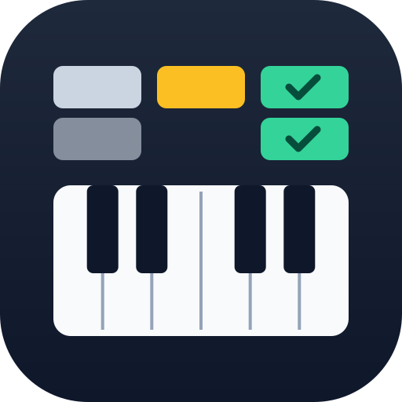

# Kanboard MCP Server

[](https://m8ven.ai/mcp/b-ak-kanboard-mcp-server-q44d8c?s=readme)
[](https://mcprush.com/to/b-ak-kanboard-mcp?ref=badge)

An [MCP](https://modelcontextprotocol.io) server that lets Claude create, update and track tasks on
your self-hosted [Kanboard](https://kanboard.org), from Claude Code, Claude Desktop, claude.ai or
the Claude mobile apps.

It talks to Kanboard only through its JSON-RPC API, so it works with any Kanboard instance you can
reach over HTTP (localhost, LAN or a public URL) and with any Kanboard database backend.

## Tools

| Tool | What it does |
|---|---|
| `list_projects` | Projects with IDs and board links |
| `get_board` | Columns of a project with their open tasks |
| `list_tasks` | Tasks in a project, filtered by `open` / `closed` / `all` and column |
| `search_tasks` | Kanboard filter syntax (`assignee:me status:open due:<=today`), one or all projects |
| `get_overdue_tasks` | Overdue tasks, for you or for one project |
| `get_task` | Details, tags, subtasks, comments and attachment list |
| `get_task_file` | Read an attachment: images come back as images, text files as text |
| `create_task` / `update_task` | Title, description, priority, column, assignee, due date, tags |
| `move_task` | Move a task to another column (by name) |
| `close_task` / `reopen_task` | Complete or reopen |
| `add_comment` | Add a progress note (Markdown) |
| `create_subtask` / `update_subtask` | Checklist items and their status |
| `list_project_users` | Assignable users |
| `list_tags` / `create_tag` / `update_tag` | Project tags: list, create (with a color), rename/recolor |
| `get_me` | Which Kanboard user and API mode the server is using |

Read-only tools are annotated as such, so Claude clients can auto-approve them and ask before writes.

## 1. Get a Kanboard API token

You can use either kind of token:

- **Personal access token (recommended):** Kanboard → *My profile* → *API* → generate a token. Set
  `KANBOARD_USERNAME` to your login name. Actions run as you and follow your project permissions.
- **Application token:** Kanboard → *Settings* → *API*. Set `KANBOARD_USERNAME=jsonrpc`. It has full
  access to every project. Set `KANBOARD_DEFAULT_USER_ID` so comments have an author.

The two are easy to mix up: the application token used with your own username fails with
`401 Unauthorized`.

Also set Kanboard's *Settings → Application settings → Application URL* to the address you open
Kanboard at; otherwise the task links Claude shows you point to `http://localhost/...`.

## 2. Use it from Claude Code on the same machine (stdio)

No clone needed. [`uv`](https://docs.astral.sh/uv/) fetches and runs the server:

```bash
claude mcp add --scope user kanboard \
  --env KANBOARD_URL=http://localhost:8080 \
  --env KANBOARD_USERNAME=your-username \
  --env KANBOARD_API_TOKEN=your-token \
  -- uvx --from git+https://github.com/b-ak/kanboard-mcp-server kanboard-mcp
```

`--scope user` makes the server available in every project; without it, it is registered for the
current folder only.

Claude Desktop's `claude_desktop_config.json` takes the same command:

```json
{
  "mcpServers": {
    "kanboard": {
      "command": "uvx",
      "args": ["--from", "git+https://github.com/b-ak/kanboard-mcp-server", "kanboard-mcp"],
      "env": {
        "KANBOARD_URL": "http://localhost:8080",
        "KANBOARD_USERNAME": "your-username",
        "KANBOARD_API_TOKEN": "your-token"
      }
    }
  }
}
```

## 3. Use it from claude.ai and the Claude mobile apps (remote HTTP)

claude.ai and the mobile apps connect from Anthropic's cloud, so the server must:

1. run where it can reach Kanboard (e.g. on the same Raspberry Pi),
2. be reachable at a **public HTTPS URL** (Cloudflare Tunnel, Tailscale Funnel or a reverse proxy),
3. require login. GitHub OAuth is built in and limited to the GitHub accounts you list.

```
Claude (web / mobile / Code) ──HTTPS──▶ tunnel/proxy ──▶ kanboard-mcp :8000 ──▶ Kanboard
```

**[docs/deployment.md](docs/deployment.md)** walks through the whole setup step by step: Kanboard
token, GitHub OAuth App, Docker Compose, Cloudflare Tunnel, connecting Claude, verification and
troubleshooting.

Once it's running at `https://kanboard-mcp.example.com`:

- **claude.ai / mobile:** *Settings → Connectors → Add custom connector*, URL
  `https://kanboard-mcp.example.com/mcp`, then sign in with GitHub. Connectors you add on claude.ai
  are also available in the Claude mobile apps.
- **Claude Code:**
  `claude mcp add --scope user --transport http kanboard https://kanboard-mcp.example.com/mcp`,
  then run `/mcp` to sign in.

## 4. Tell Claude when to use it

Connecting gives Claude the tools, not the habits. Put your rules (which project, when to create,
move, comment or close tasks, what to ask first) in your project's `CLAUDE.md` or a claude.ai
Project's instructions. Start from **[docs/claude-md-template.md](docs/claude-md-template.md)**.

## Configuration

All settings are environment variables. See [.env.example](.env.example). The CLI also accepts
`--env-file`, `--transport`, `--host` and `--port`.

| Variable | Default | Description |
|---|---|---|
| `KANBOARD_URL` | required | Kanboard base URL; `/jsonrpc.php` is appended if missing |
| `KANBOARD_USERNAME` | `jsonrpc` | Your username (personal token) or `jsonrpc` (application token) |
| `KANBOARD_API_TOKEN` | required | API token |
| `KANBOARD_DEFAULT_USER_ID` | | Comment author when using the application token |
| `KANBOARD_VERIFY_SSL` | `true` | Set `false` for self-signed certificates |
| `KANBOARD_TIMEOUT` | `20` | Request timeout in seconds |
| `MCP_TRANSPORT` | `stdio` | `stdio` or `http` |
| `MCP_HOST` / `MCP_PORT` | `127.0.0.1` / `8000` | HTTP bind address (Docker image uses `0.0.0.0`) |
| `MCP_AUTH` | `none` | `none`, `bearer` or `github` |
| `MCP_BEARER_TOKEN` | | Shared secret for `bearer` (32+ chars) |
| `MCP_BASE_URL` | | Public URL of this server, for `github` |
| `GITHUB_CLIENT_ID` / `GITHUB_CLIENT_SECRET` | | GitHub OAuth app credentials |
| `MCP_ALLOWED_GITHUB_USERS` | | Comma-separated GitHub logins allowed to connect |
| `MCP_JWT_SIGNING_KEY` | derived | Optional key for tokens the server issues |
| `FASTMCP_HOME` | `~/.local/share/fastmcp` | Where OAuth state is stored (`/data` in Docker) |

The server refuses to serve HTTP on a non-loopback address without authentication, unless you set
`MCP_ALLOW_UNAUTHENTICATED=true` because a proxy in front of it already handles auth.

## Development

```bash
uv sync
uv run pytest
uv run ruff check . && uv run ruff format --check .
uv run kanboard-mcp --env-file .env                      # stdio
uv run kanboard-mcp --env-file .env --transport http     # http on 127.0.0.1:8000
npx @modelcontextprotocol/inspector                      # optional: browse the tools
```

## License

Apache-2.0
